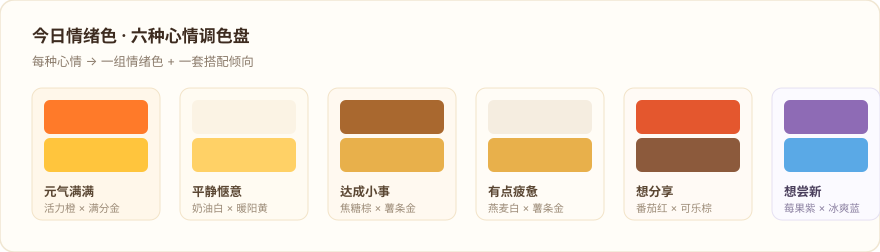
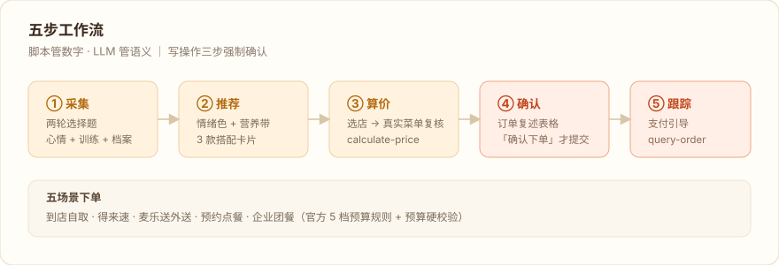

# 麦麦心情调色盘 mcd-mood-palette

> 今天的心情，值得一份什么样的麦麦。

心情调色盘按你当下的情绪调出「今日情绪色」，按健身目标与训练状态守住「营养带」，在 160+ 款麦当劳餐品中收敛出 3 款搭配——选中即可一路走到真实门店算价与下单。为「今天吃什么麦麦」纠结过的人而做。



## 它怎么工作



```
"今天吃什么麦麦"
   ↓ 两轮选择题（心情 6 选 1 + 今日训练）
   ↓ 情绪 → 今日情绪色（焦糖棕 × 薯条金）
   ↓ 营养带（减脂·力量日·午餐 → 450–800 kcal · 蛋白≥35g）
   ↓ 过敏原/忌口黑名单过滤 + 组合打分
   ↓ 3 款搭配卡片（热量/蛋白/理由/降档建议）
   ↓ 选店 → 算价 → 复述确认 → 下单 → 支付跟踪
```

- **情绪体验匹配**：6 种心情映射 6 组情绪色与搭配倾向（庆祝→招牌仪式感；疲惫→经典老朋友；尝新→联动当日新品活动）
- **营养区间硬约束**：160+ 餐品营养数据 × 目标（减脂/增肌/保持）× 训练日 × 时段，动态计算热量/蛋白区间；超限组合自动给「换小份」降档建议
- **套餐优先 + 性价比排序**：四维打分 `0.40 营养 + 0.25 情绪 + 0.20 性价比 + 0.15 套餐加成`，性价比含省钱率/营养单价/口碑三因子
- **过敏原/忌口保护**：首次使用录入档案，本地保存（绝不上传），之后每次推荐自动过滤
- **五种下单场景**：到店自取 / 得来速 / 麦乐送外送 / 预约点餐 / 企业团餐（按聚餐目的+人均预算走官方 5 档搭配规则）
- **三步强制确认**：选定推荐 → 订单复述+「确认下单」→ 支付状态跟踪，写操作绝不静默执行

## 安装

**前置条件**：[WorkBuddy](https://www.workbuddy.cn) + 麦当劳 MCP Token（在 [MCP 开放平台](https://open.mcd.cn/mcp) 登录后于控制台申请）

1. **配置 MCP 连接器**：WorkBuddy → 左侧【专家·技能·连接器】→【连接器】→ 右上角【自定义连接器】→【配置 MCP】，粘贴以下 JSON（**把 YOUR_MCP_TOKEN 替换为你的真实 Token**）：

   ```json
   {
     "mcpServers": {
       "mcd-mcp": {
         "type": "streamablehttp",
         "url": "https://mcp.mcd.cn",
         "headers": {
           "Authorization": "Bearer YOUR_MCP_TOKEN"
         }
       }
     }
   }
   ```

   保存后在【自定义连接器】中启用 `mcd-mcp`。（也可直接使用仓库根目录的 `mcp-config.example.json`）

2. **安装技能**：将本仓库克隆/复制到用户技能目录：

   ```bash
   git clone https://github.com/LewisLeeYu-AIR/mcd-mood-palette.git
   # Windows
   xcopy /E /I mcd-mood-palette "%USERPROFILE%\.workbuddy\skills\mcd-mood-palette"
   # macOS / Linux
   cp -r mcd-mood-palette ~/.workbuddy/skills/mcd-mood-palette
   ```

3. **验证**：在 WorkBuddy 新会话输入「今天吃什么麦麦」，技能应被触发并开始两轮采集。

## 使用示例

**个人餐**（真实运行输出，2026-10-12 实测）

```
你：刚健完身，想吃麦当劳
调色盘：现在是用餐时段，先问一下，今天心情更接近哪种？
       [元气满满] [平静惬意] [达成小事] [有点疲惫] [想分享] [想尝新]
你：有点疲惫
调色盘：今天练的是哪种？[力量日] [有氧日] [今天没关注]
你：力量日
调色盘：麦麦心情调色盘 · 今日配方
       今日情绪色：燕麦白 × 薯条金（有点疲惫，想吃点熟悉稳妥的）
       今日营养带：450–800 kcal · 蛋白≥35g（减脂·力量日·午餐）
       ──────────────────────
       A 精选单人餐三件套（板烧鸡腿堡+中薯条+可乐中杯）
          ¥33.5 · 单点合计 ¥46.5 · 省 ¥13.0
          591 kcal（换小杯玉米杯后）· 蛋白 25g
       B 人气超值四件套随心选（麦辣鸡腿堡+中薯条+麦乐鸡4块+可乐中杯）
          ¥27.0 · 单点合计 ¥57.5 · 省 ¥30.5
          708 kcal（换玉米杯+无糖可乐后）· 蛋白 36g ✓
       C 板烧鸡腿堡 + 热奶铁大杯   ¥33.5 · 631 kcal · 蛋白 36g ✓
       ＊营养与过敏原信息仅供参考，不构成营养或医疗建议
你：就要 B
调色盘：好的。帮你查了附近门店：麦当劳XX路店(420m) 选哪家？取餐方式？[到店自取][得来速][麦乐送][预约]
你：到店自取
调色盘：订单确认前请过目——
       | 餐品 | 数量 | 门店 | 取餐方式 | 总价 | 预计热量 |
       | 人气超值四件套（换玉米杯+无糖可乐） | 1 | XX路店 | 到店自取 | ¥27.0 | 708kcal |
       回复「确认下单」我才会提交订单。
你：确认下单
调色盘：订单已创建 🎉 请通过支付链接扫码或打开麦当劳 APP 完成支付，
       支付完成后回复「支付完成」或「支付失败」，我帮你确认状态。
```

**团队聚餐**

```
你：周五组里 8 个人团建点麦当劳，人均 25 左右
调色盘：团建快乐！聚餐目的是？[项目庆功][部门团建][朋友聚会][家庭聚餐]
你：部门团建
调色盘：按官方搭配规则，人均 25 元落在「汉堡+小食」档；
       预算校验后给你配了每人：汉堡包 + 迷你薯条（人均 ¥23，预算内）
       团队有忌口或过敏的同学吗？
（后续同样：选店 → 算价 → 复述 ×人数 → 确认下单）
```

## 目标用户

- **麦门爱好者**：日常高频吃麦当劳，但每次都在菜单前纠结 10 分钟的人
- **健身不减麦**：有减脂/增肌目标又不想放弃麦当劳的上班族与学生（程序员友好）
- **小团队组织者**：经常要替部门/小组订团餐的行政与开发组长

## 质量验证

项目在开发期完成了三轮系统性验证，全部记录在仓库内：

| 验证 | 内容 | 结果 |
|---|---|---|
| 发布门禁 `scripts/self_check.py` | 六件套完整性 / 声明 SHA / Token 泄漏扫描 / 禁用词 / JSON 结构 / 重复键 / 语法 / 引擎冒烟 | **10/10 PASS** |
| 零成本全流程测试 [TEST_PLAN.md](./TEST_PLAN.md) | 6 阶段约 40 项检查（数据管道→引擎→MCP 只读→写操作闭环→异常路径） | **全通过，零费用** |
| 真实门店实测 [E2E_REAL_TEST.md](./E2E_REAL_TEST.md) | 推荐→确认→算价→创建→查询→取消 全链路 | **12/12** |
| 端到端逻辑审查 [E2E_LOGIC_AUDIT.md](./E2E_LOGIC_AUDIT.md) | 数据流转 / 状态传递 / 异常处理逐环节审查 | **15 项问题全部修复** |

测试期间的订单全部「创建→查询→取消」闭环，**零支付、零积分消耗**（未支付订单 15 分钟自动过期兜底）。

## 项目结构

```
mcd-mood-palette/
├── SKILL.md                    # 技能定义（触发词/工作流/下游铁律/错误处理）
├── MCP_INTEGRATION.md          # MCP 接口说明（17 个 Tool + 三条主链路）
├── mcp-config.example.json     # 脱敏配置示例（仅环境变量占位符）
├── CONTEST_DECLARATION.md      # 参赛声明（与官方逐字节一致）
├── workbuddy.md                # WorkBuddy 开发对话实录
├── scripts/                    # 引擎（仅标准库）
│   ├── recommend_engine.py     #  推荐引擎：过滤+候选生成+四维打分（个人/团餐）
│   ├── bridge_name.py          #  营养名 ↔ 门店菜单名四层桥接
│   ├── parse_nutrition.py      #  营养接口 → 结构化缓存
│   ├── profile_manager.py      #  用户档案 CRUD（本地）
│   ├── palette_common.py       #  共享常量与工具
│   └── self_check.py           #  发布前一键自查
├── references/                 # 数据底座
│   ├── set_meals.json          #  套餐库（10 款：构成/营养/参考价/可换子项）
│   ├── price_ref.json          #  单品参考价表（含不可售黑名单）
│   ├── emotion_palette.json    #  6 情绪 → 体验标签/色彩/话术
│   ├── nutrition_bands.json    #  健身目标 × 训练 × 时段 → 营养区间
│   ├── allergen_map.json       #  过敏原关键词黑名单
│   ├── food_experience_map.json#  156 餐品品类与体验标签
│   └── interaction_flows.md 等 #  对话流/下单手册/合规话术
└── assets/                     # README 配图
```

## 使用提示

- 首次使用会询问过敏原/忌口/健身目标，保存在本地 `data/profile.json`（已 gitignore，绝不上传）
- 营养与过敏原信息基于官方 MCP 接口与名称关键词推断，仅供参考，不构成营养或医疗建议，最终以门店公示信息及产品包装为准
- 本项目为麦当劳程序员节创意开发大赛参赛作品，由个人开发者独立开发，非麦当劳官方产品

## License

MIT（见 [LICENSE](LICENSE)）
